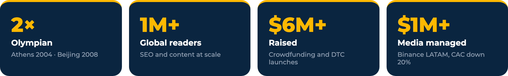
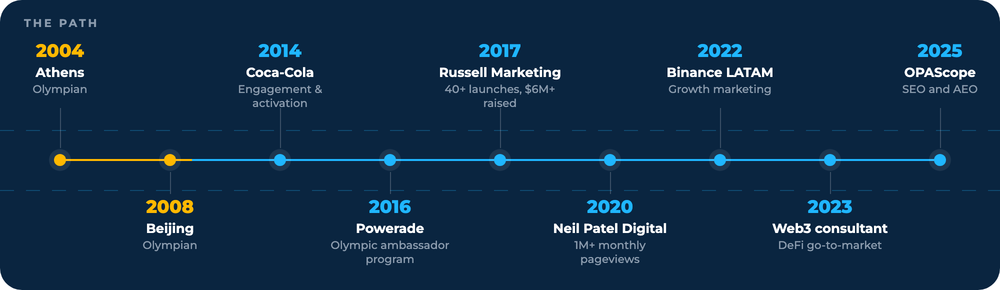
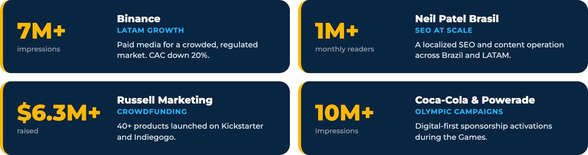
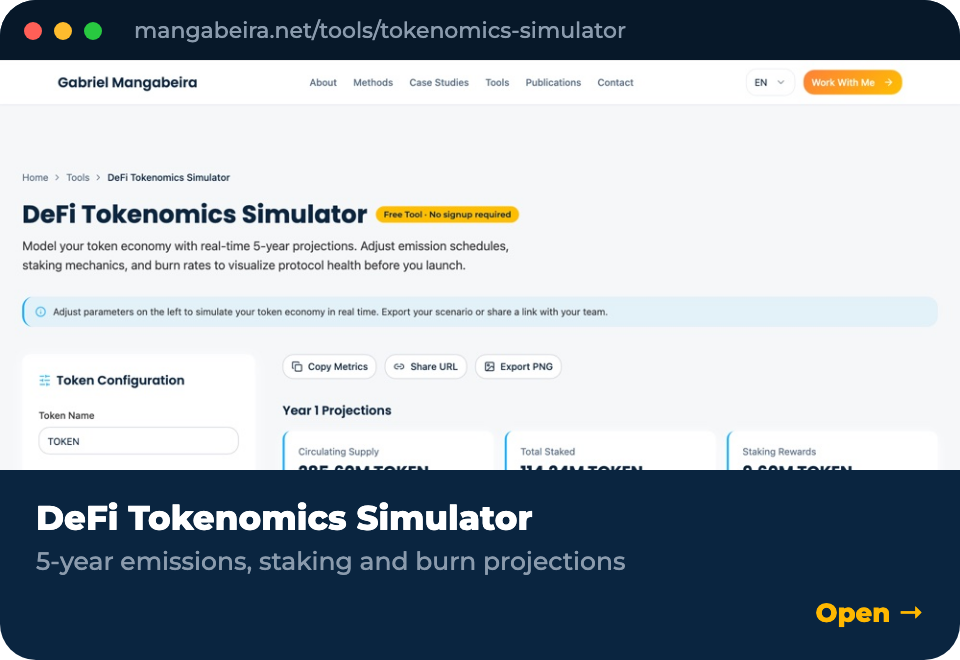
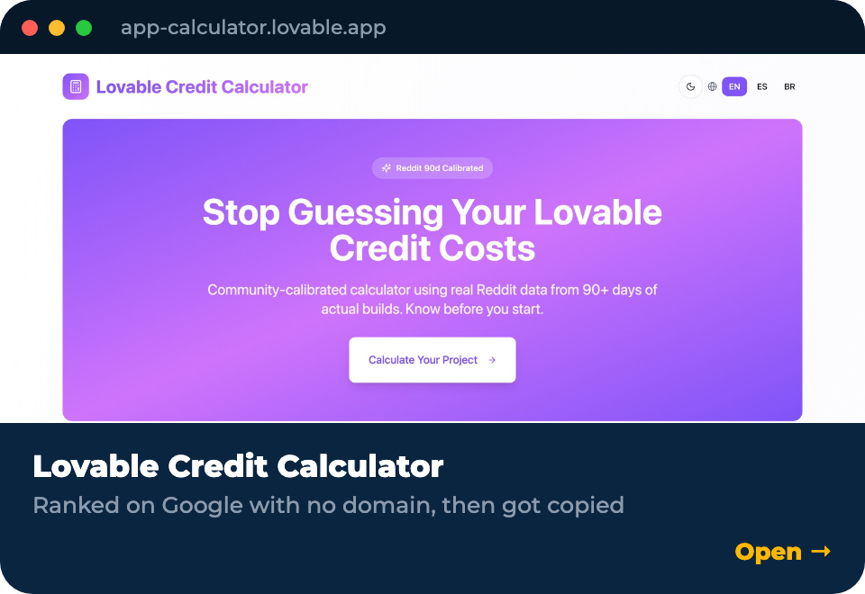
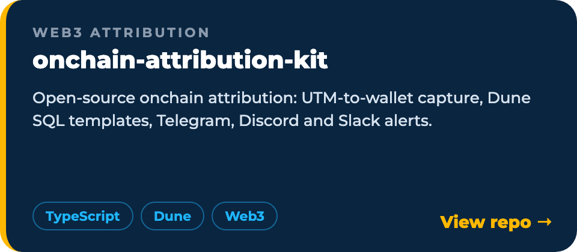
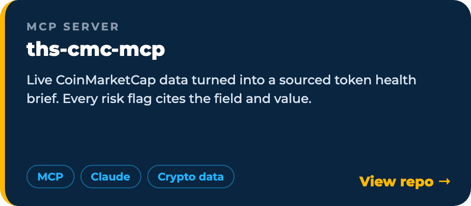
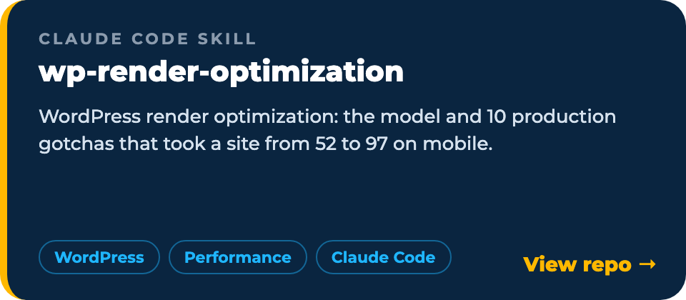
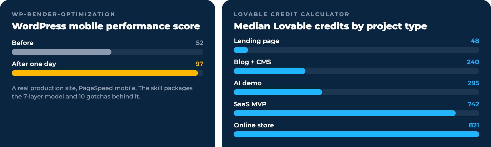

  
  
  
  

I grew up in the water, chasing hundredths of a second. That pursuit took me to two Olympic Games, where I learned that discipline, resilience and focus are everything. I carried the same principles into digital marketing: instead of chasing medals, I help AI and Web3 companies chase measurable growth.

## 🏊 The path

## 📈 Growth stories

## 🛠️ Tools I built

  
  

## 🧩 Open source

  
  
  
  

## 📊 Results in numbers

## 🧠 What I work on

| | |
|---|---|
| **AI-powered growth** | Campaigns optimized in real time, high-converting content, personalization at scale |
| **Web3 growth** | Go-to-market for DeFi protocols, community funnels, onchain attribution, Web3 SEO |
| **SEO and AEO** | Organic growth for search engines and AI assistants |
| **Data-driven performance** | Attribution, automation and systems that turn data into growth decisions |

  
  
  
  
  
  
  
  

## ✍️ Recent writing

- [The definitive guide to Web3 SEO](https://mangabeira.net/publications/definitive-guide-web3-seo)
- [DeFi case study: Avici](https://mangabeira.net/publications/case-study-defi-avici)
- [Uniswap growth audit from public evidence](https://mangabeira.net/publications/uniswap-growth-audit-evidence)
- [All publications →](https://mangabeira.net/publications)

---

<b>Building a DeFi or AI product and want growth that shows up in the numbers?</b> 
<a href="https://mangabeira.net/services/web3-growth-audit">Start with the Web3 Growth Audit</a> · <a href="https://linkedin.com/in/mangabeira">Say hi on LinkedIn</a>

